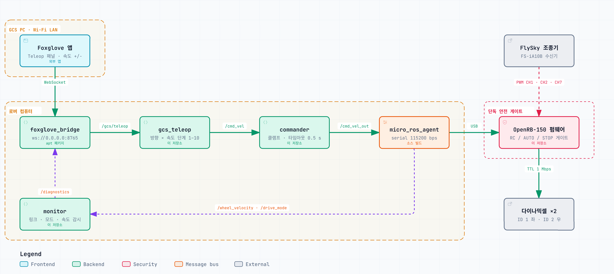

# UEL_Rover

**UEL Rover** 의 로봇 소프트웨어 프레임워크 **ROS 2** 기반 소프트웨어 템플릿



## 구성

| 구성 | 하는 일 | 위치 |
|---|---|---|
| 제어보드 (OpenRB-150) | 모터 구동, 조종기 신호 처리 | [firmware/](firmware/OpenRB-150/README.md) |
| 로버 컴퓨터 (Jetson) | ROS2 기반 로버 제어 | [ros2_ws/](ros2_ws/src/uel_rover/README.md) |
| GCS PC | 웹 기반 GCS | [gcs/](gcs/README.md) |

## 빠른 시작

1. **제어보드**: Arduino IDE 로 `firmware/OpenRB-150/OpenRB-150.ino` 를 올린다.
2. **로버 컴퓨터** (Ubuntu 24.04): 설치 스크립트를 실행하고 재로그인한다.
   ```bash
   git clone https://github.com/Porofly/UEL_Rover.git
   cd UEL_Rover
   ./scripts/setup.sh --bashrc
   ```
3. **실행**: 로버에서 아래를 실행하고, GCS PC 의 Foxglove 에서 `ws://<로버 IP>:8765` 로 접속한다.
   ```bash
   ros2 launch uel_rover bringup.launch.py     # 제어 스택
   ros2 launch uel_rover gcs.launch.py         # GCS 연결 (선택)
   ```

단계별 설명은 [초기 설정](docs/getting-started.md), 이후 사용법은 [사용법](docs/usage.md).

## 문서

| 알고 싶은 것 | 문서 |
|---|---|
| 처음 보는 용어 | [용어집](docs/glossary.md) |
| 제어보드·로버 컴퓨터·GCS PC 설치 | [초기 설정](docs/getting-started.md) |
| 실행, 조종기 스위치, 동작 확인, GCS 조종 | [사용법](docs/usage.md) |
| 노드, 토픽, 파라미터 | [ROS 2 노드와 인터페이스](docs/ros-interface.md) |
| 저장소 구조, 기능 추가, 펌웨어·파라미터 수정 | [개발 가이드](docs/development.md) |
| 오류 대처, 배포 전 확인할 주의사항 | [문제 해결과 주의사항](docs/troubleshooting.md) |
