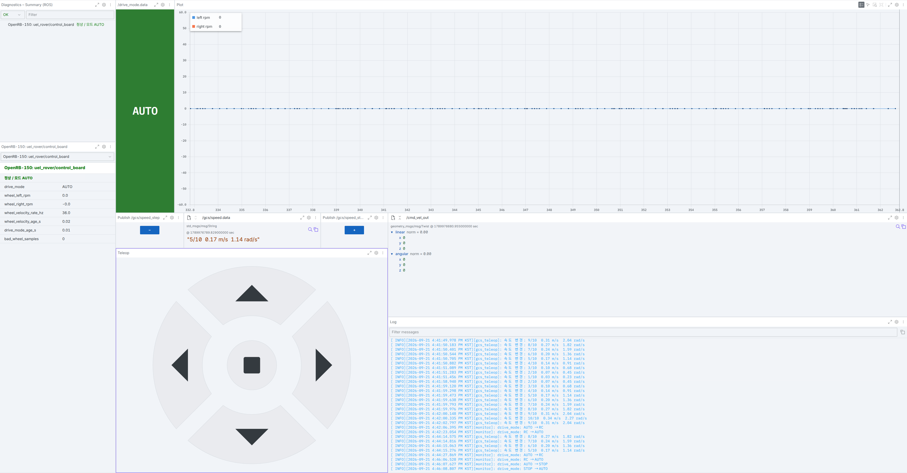

# 사용법

[초기 설정](getting-started.md) 을 마친 뒤의 기본 사용법. 모르는 용어는 [용어집](glossary.md) 을 본다.

## 실행

로버에서 터미널 두 개를 연다. GCS 를 쓰지 않으면 두 번째는 생략한다.

```bash
ros2 launch uel_rover bringup.launch.py     # micro_ros_agent + commander + monitor
ros2 launch uel_rover gcs.launch.py         # foxglove_bridge, ws://0.0.0.0:8765
```

| launch | 인자 | 기본값 | 설명 |
|---|---|---|---|
| bringup | `serial_port` | `/dev/ttyACM0` | 제어보드 USB 시리얼 장치 |
| bringup | `baudrate` | `115200` | micro-ROS 시리얼 보레이트 |
| bringup | `start_agent` | `true` | `false` 면 agent 를 따로 띄운다 |
| bringup | `params_file` | `config/rover.yaml` | commander / monitor 파라미터 |
| gcs | `port` | `8765` | WebSocket 포트 |
| gcs | `address` | `0.0.0.0` | 바인드 주소. `127.0.0.1` 이면 로버 안에서만 접속 |
| gcs | `params_file` | `config/foxglove_bridge.yaml` | foxglove_bridge 파라미터 |

예: `ros2 launch uel_rover bringup.launch.py serial_port:=/dev/ttyACM1`

## 조종기 스위치 (드라이브 모드)

| CH7 스위치 | 모드 | 동작 |
|---|---|---|
| 기본 위치 (≥ 1700 µs) | **STOP** | 즉시 정지 |
| 가운데 (1400 ~ 1600 µs) | **AUTO** | `/cmd_vel_out` 적용. agent 연결 + 새 명령 수신 + 500 ms 워치독을 모두 만족할 때만 구동 |
| 반대쪽 끝 (≤ 1300 µs) | **RC** | 조종기로 직접 구동. 소프트웨어 명령 무시 |

처음 켤 때는 STOP(기본 위치)에 두고, 소프트웨어로 움직일 때만 AUTO 로 넘긴다.
비상시에는 AUTO 에서 어느 쪽으로든 한 칸 넘기면 소프트웨어 명령이 끊긴다. RC 에서 STOP 으로
갈 때는 AUTO 를 거치므로 가운데에서 멈추지 말고 끝까지 넘긴다.

## 동작 확인

```bash
ros2 topic echo /diagnostics        # uel_rover/control_board 상태: OK / WARN / ERROR / STALE
ros2 topic echo /drive_mode         # 조종기 스위치 상태 "RC" | "AUTO" | "STOP"
ros2 topic hz /wheel_velocity       # 제어보드 링크 확인, 약 50 Hz

# 조종기를 AUTO 로 둔 상태에서 (10 Hz 로 반복 발행해야 계속 움직인다)
ros2 topic pub -r 10 /cmd_vel geometry_msgs/msg/Twist "{linear: {x: 0.1}}"
# 또는 키보드 조종 (sudo apt install ros-jazzy-teleop-twist-keyboard)
ros2 run teleop_twist_keyboard teleop_twist_keyboard
```

`/diagnostics` 의 레벨 의미: STALE 은 제어보드에서 아직 아무것도 못 받음, ERROR 는 받다가
끊김, WARN 은 비물리적 바퀴 속도 감지, OK 는 정상 (message 에 현재 모드 표시).

## GCS 에서 보고 조종하기



1. Foxglove 에서 **Open connection → Foxglove WebSocket**, URL `ws://<로버 IP>:8765`.
2. 접속되면 Diagnostics 패널에 `uel_rover/control_board` 가, Indicator 에 드라이브 모드 색이 뜬다.
3. 조종기를 **AUTO** 로 두고 Teleop 패널 방향 버튼을 누르면 움직인다. 속도는 Teleop 위의
   **"−" / "+" 버튼**으로 1 ~ 10 단계를 오가며 바꾸고(시작 0.12 m/s · 0.82 rad/s, 최고는
   RC 풀 입력과 같은 0.306 m/s · 2.04 rad/s), 두 버튼 사이에 현재 값이 표시된다. 버튼을 떼면 즉시 정지한다.
4. 패널별 설명과 문제 해결은 [gcs/README.md](../gcs/README.md).

문제가 생기면 [문제 해결](troubleshooting.md).
